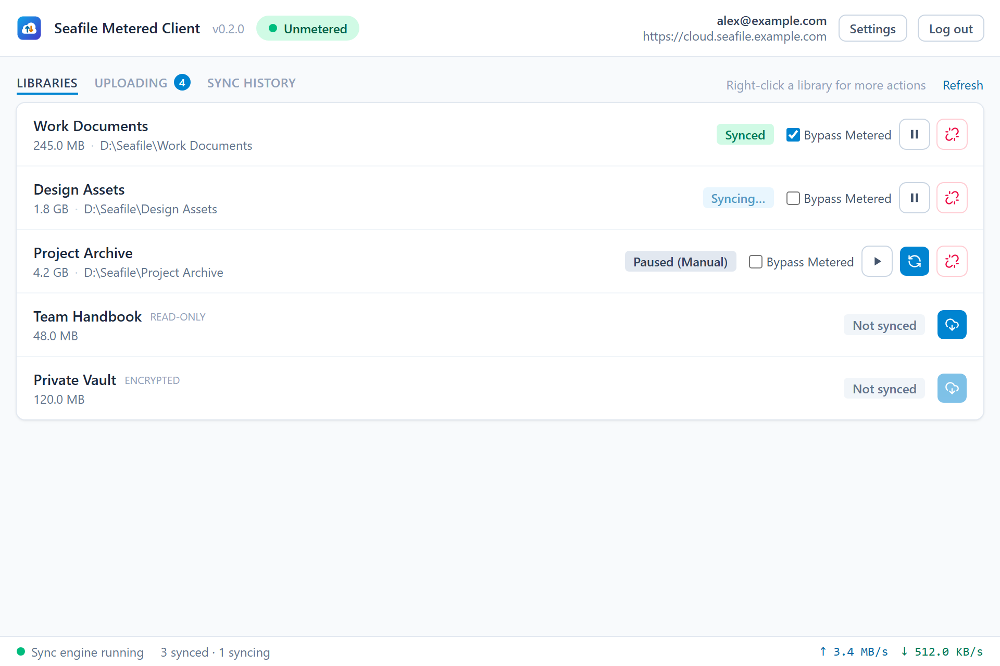
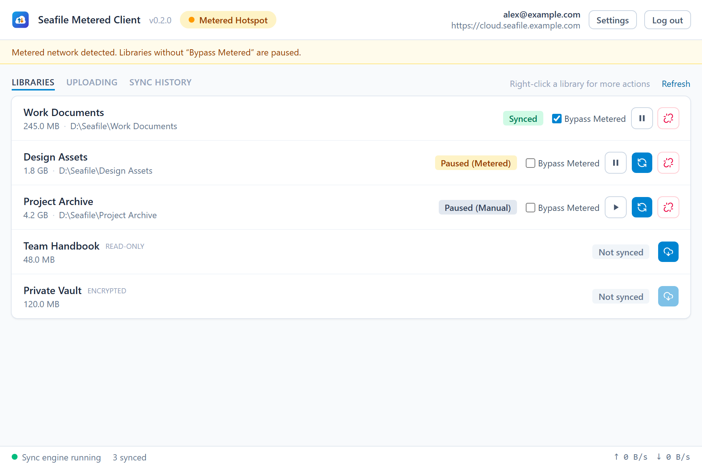
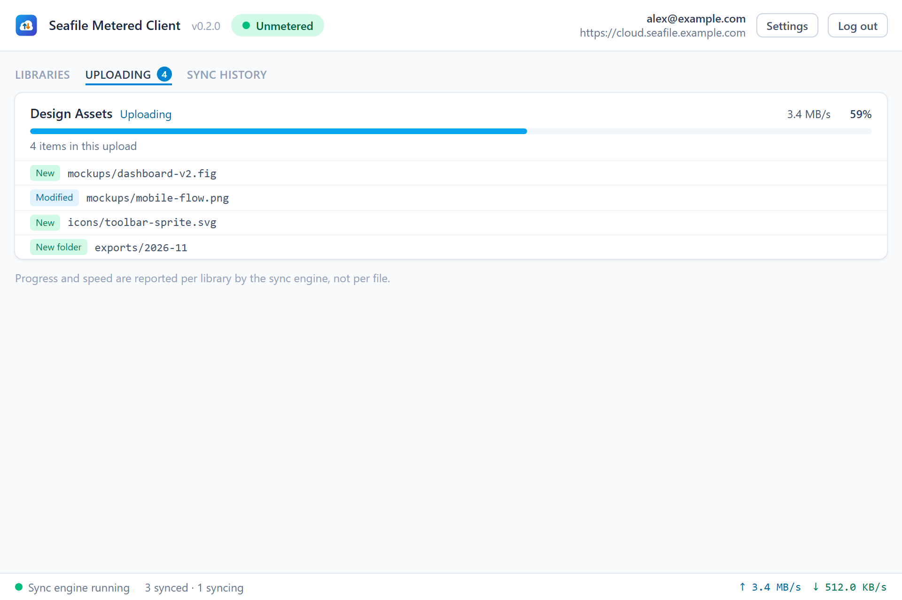
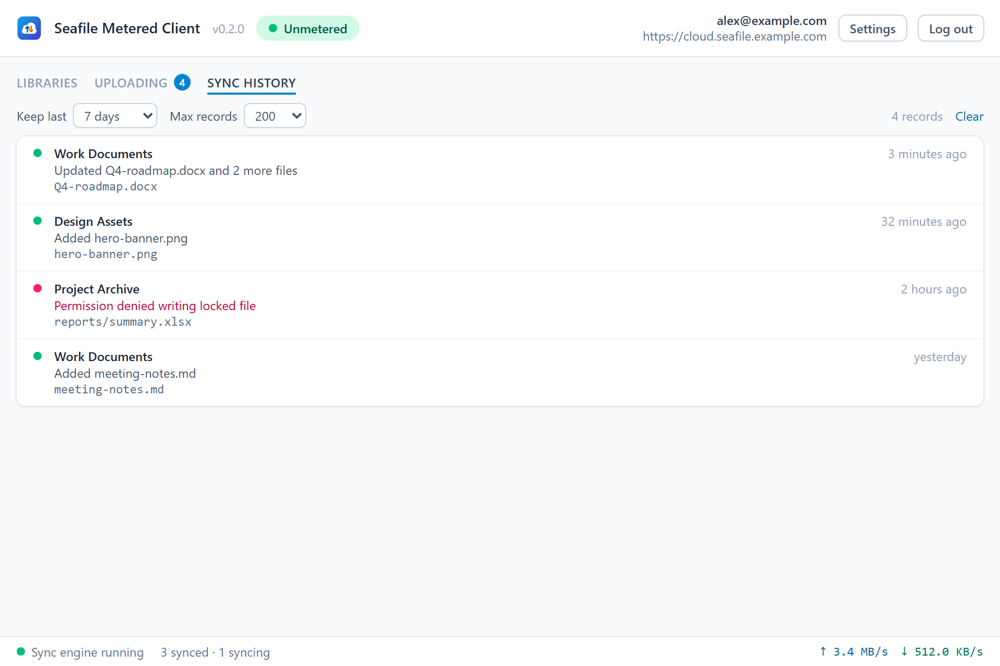
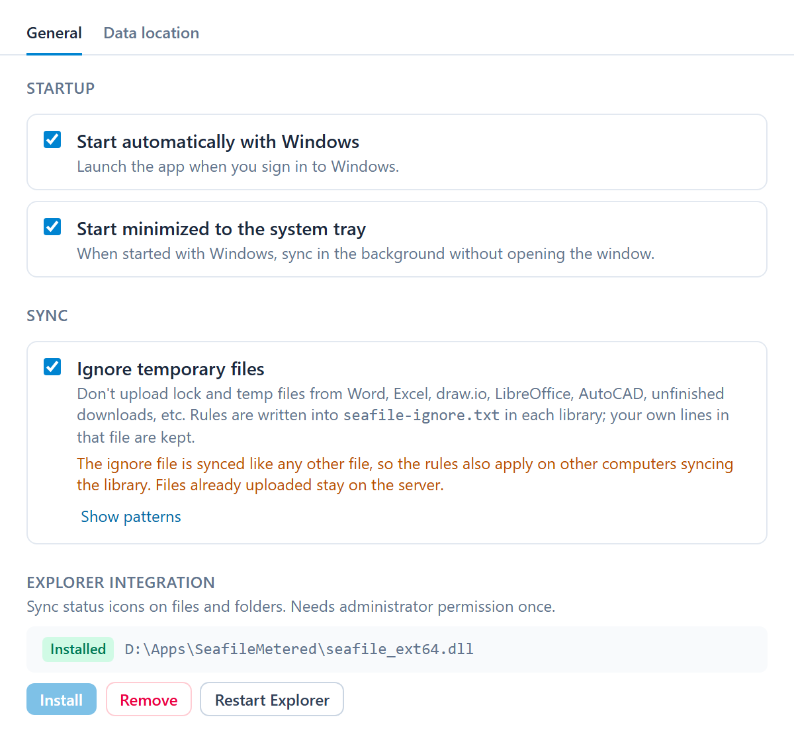
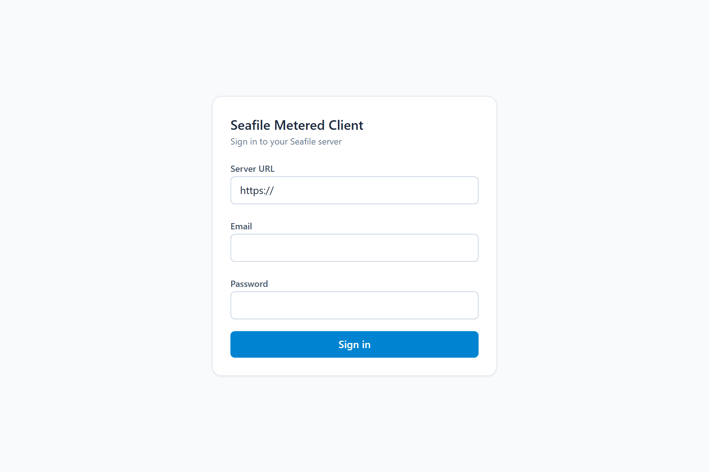

# Seafile Metered Client

A lightweight custom **Seafile** desktop client for **Windows**, built with **Tauri** (Rust + React + TypeScript + Tailwind CSS).

Its primary goal is to prevent heavy, bandwidth-consuming libraries from downloading or uploading on **Metered Networks** (such as Mobile Hotspots or metered Wi-Fi), while still allowing specific lightweight libraries (such as **Documents** or notes) to sync automatically—and staying **ultra-lightweight (~40 MB RAM)** with near-zero idle CPU when running in the background without the UI open.

---

## Features

- **Smart Metered Network Awareness**
  - Event-driven detection of Windows network status (`Unmetered` vs. `Metered Hotspot`) via `INetworkListManager`.
  - **Block heavy syncs on metered connections**: automatically pauses large/media libraries without **Bypass Metered** to save mobile data and bandwidth, and resumes them automatically when returning to an unmetered network.
  - **Selective auto-sync via `Bypass Metered`**: allow specific essential or lightweight libraries (e.g., **Documents**, **Notes**) to keep syncing automatically even on metered networks.
  - **Force sync** action to run a one-time sync on a paused library without unpausing it.

- **Library Management**
  - Fetches cloud libraries from your Seafile server and lets you map any library to a local folder.
  - Compact per-row status badges (`Synced`, `Syncing…`, `Paused (Metered)`, `Paused (Manual)`, `Error`, `Not synced`) and icon action buttons with tooltips.
  - Right-click context menu for quick actions: **Sync now**, **Open local folder**, **View on cloud**, **Last error…**, and **Unsync** (keeps local files).

- **Live Uploads & Sync History**
  - **Uploading** tab with real-time per-library upload progress, transfer speed, and file list.
  - **Sync history** tab showing completed syncs and errors, with relative/exact timestamps and configurable retention (**Keep last** 1–365 days, **Max records** 10–5000).

- **System Tray & Background Daemon**
  - **Ultra-lightweight in the background (~40 MB RAM)**: when minimized to the system tray with the window closed/hidden, the WebView UI is not active and idle CPU usage stays near 0%.
  - Runs silently in the Windows system tray with a status indicator dot (green = up to date, blue = syncing, red = error) and live upload/download speeds.
  - Automatic lifecycle management of the bundled `seaf-daemon.exe` sidecar.
  - Status bar displaying engine state, synced library counts, and current transfer rates.

- **Windows Integration & Settings**
  - **Start automatically with Windows** and **Start minimized to the system tray**.
  - **Ignore temporary files**: manages `seafile-ignore.txt` rules for Office, LibreOffice, WPS, draw.io, AutoCAD, unfinished browser downloads, editor swap files, and OS metadata (`desktop.ini`, `Thumbs.db`, `.DS_Store`).
  - **Explorer Integration**: optional Windows Explorer status icon overlays (`seafile_ext64.dll`).
  - **Data Location**: switch between Portable, `LocalAppData`, or a Custom folder.
  - **Secure Credential Storage**: authenticates via Seafile REST API and persists session tokens encrypted with Windows DPAPI.

---

## Screenshots

### Libraries — Unmetered Network


### Libraries — Metered Hotspot


### Uploading


### Sync History


### Settings


### Login


---

## Tech Stack

- **Frontend:** React 19, TypeScript, Tailwind CSS v4, Vite
- **Backend / Desktop Shell:** Tauri v2, Rust, `seaf-daemon.exe`

---

## Development & Build

### Prerequisites
- [Node.js](https://nodejs.org/) & [pnpm](https://pnpm.io/)
- [Rust](https://www.rust-lang.org/) (MSVC toolchain on Windows)

### Commands

```bash
# Install frontend dependencies
pnpm install

# Run in development mode (Vite + Tauri)
pnpm tauri dev

# Type-check and build frontend
pnpm build

# Build release binary (Windows)
pnpm release
```
